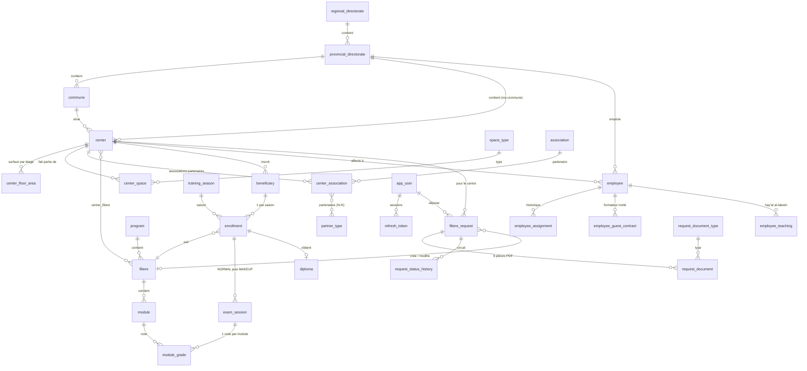

# Modèle de données

Source de vérité : `backend/src/main/resources/db/migration/V1…V7`. MySQL 8, InnoDB, `utf8mb4_unicode_ci`.
Les énumérations sont des `VARCHAR` + `CHECK` (lisibles en SQL, évolutives par migration).

## Points clés

| Sujet | Décision |
|---|---|
| **Hiérarchie** | Région → Province → Commune → Centre. La FK composite `center(commune_id, provincial_directorate_id)` interdit une commune d'une autre province. |
| **Situation sociale** (multi-choix) | `is_vulnerable`, `disability_type`, `migration_status`, `other_social_situation_text` sur `beneficiary`. Un champ non `NULL` = la personne appartient à la catégorie. |
| **Catégorie statistique** | Colonne générée `beneficiary.stat_category` : MIGRANT > DISABLED > OTHER > REMAINING (voir `statistics-rules.md`). |
| **Âge** | Jamais stocké : calculé depuis `birth_date`. |
| **Inscription** | Une par bénéficiaire et par saison. FK composite `(center_id, filiere_id)` → `center_filiere` : on ne s'inscrit qu'à une filière assignée au centre. |
| **Statuts** | `ENROLLED`, `DEPARTED` (date obligatoire), `GRADUATED`, `FAILED`, `ABSENT` (compté à part des recalés). |
| **Examens** | `exam_session` NORMAL puis MAKEUP (rattrapage de **tous** les examens). Moyenne générale = (moyenne pondérée des modules + examen final) / 2, seuil 10 modifiable, réussite exceptionnelle avec justification. |
| **Saison courante** | Une seule, garantie par un index unique sur colonne générée. |
| **RH** | `employee_type` (صفة) × `administrative_status` (وضعية إدارية). Champs Entraide Nationale (`en_grade`, `en_scale`, `rank_number`) obligatoires uniquement pour ce statut. `extra_data` JSON pour de futurs champs. Les compteurs de la fiche centre sont calculés par `GROUP BY`. |
| **Sécurité** | `app_user.role` : ADMIN, REGIONAL, PROVINCIAL (+ CENTER_MANAGER, HR_OFFICER, READ_ONLY réservés). Un `CHECK` impose la cohérence rôle ↔ périmètre. Jetons de rafraîchissement stockés hachés (SHA-256). |
| **Demandes de filière** | DRAFT → SUBMITTED → REGIONAL_VALIDATED → APPROVED (ou RETURNED / REJECTED). 8 pièces PDF, 20 Mo max (contrainte en base). À l'approbation : création de la filière **et** affectation au centre (`resulting_filiere_id`). |
| **Audit** | `audit_log` (qui, quand, quoi, valeurs avant/après en JSON). |

## Jeux de données

- **Référence** (migrations, tous environnements) : 12 régions, 13 types d'espaces (المرافق), 3 types de partenaires provisoires, 8 types de pièces, programme CEF.
- **Dev** (`db/seed-dev`, profil `dev` uniquement) : 3 directions provinciales, 5 centres, 3 filières avec modules, 20 bénéficiaires couvrant toutes les catégories et tous les statuts, sessions d'examen (dont un rattrapage), diplômes, 5 employés. Aucun compte utilisateur : voir l'étape sécurité.

## Découpage territorial et référentiels (V11)

- 12 régions (`regional_directorate`, codes `01`–`12`), 82 provinces / préfectures (`provincial_directorate`) et 1 523 communes
  (`commune`) proviennent des tables officielles fournies par l'Entraide Nationale. Les noms français reprennent le nom arabe
  tant qu'ils ne sont pas saisis. Code d'une province : code région (2 chiffres) + rang (2 chiffres) ; pour la région 06,
  Casablanca-Anfa = `0601` et Mohammedia = `0602`.
- `partner_type` : 23 partenaires (الشركاء) ; `requires_specification` pour ceux « مع تحديده » ; la précision est stockée dans
  `center_association.partner_specification`.
- `land_provider` : 13 organismes « موضوع رهن الإشارة » ; `center.land_provider_id` (obligatoire pour la situation foncière
  « mis à disposition de l'Entraide Nationale »).
